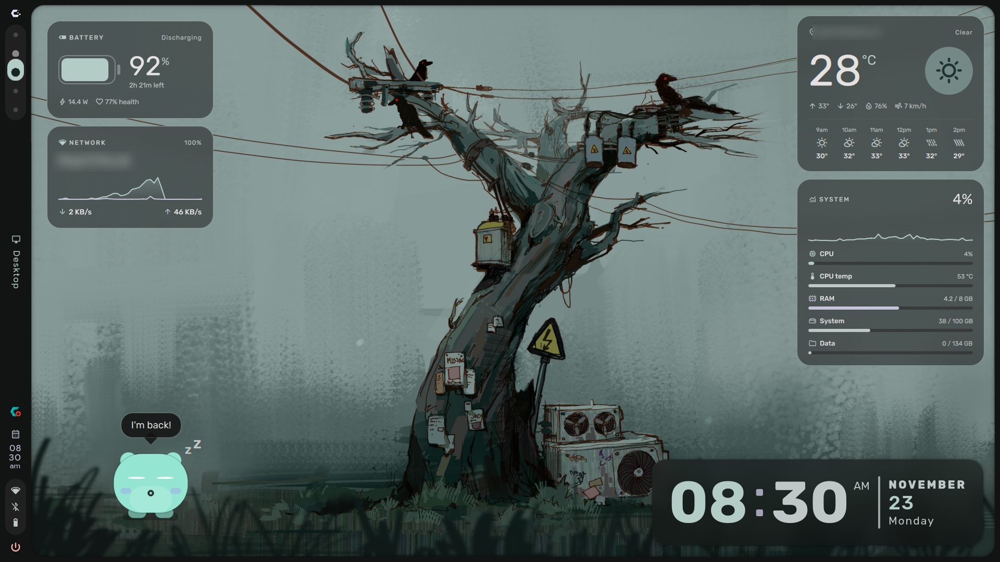

# desk-widgets

Glass desktop widgets and an interactive desktop buddy for [Quickshell](https://quickshell.org) on
Hyprland. Everything sits on the desktop layer behind your windows and takes its colours from the
current wallpaper through [Caelestia](https://github.com/caelestia-dots/shell).



*The town and Wi-Fi name are blurred in this screenshot. The large clock in the corner and the side
bar belong to Caelestia, not to this project.*

## What you get

### Widgets (`shell.qml`)

| Card | Shows |
|---|---|
| **Battery** | charge, time left, power draw in watts, battery health |
| **Network** | connection name, Wi-Fi signal, live download and upload speed with a graph |
| **Weather** | current conditions, high and low, humidity, wind, and the next six hours |
| **System** | CPU load with a graph, CPU temperature, RAM, and disk usage |

The weather location is found automatically (GeoClue first, then your IP address), or you can set
fixed coordinates. Weather data comes from [Open-Meteo](https://open-meteo.com); no API key is needed.

### The buddy (`Pet.qml`)

A small creature that lives on an empty workspace.

- **It watches you.** Its eyes follow the mouse cursor, and it blinks and breathes.
- **It reacts.** Hover and it perks up, click and it hops and says something, drag to move it. It
  remembers where you put it.
- **It has moods.** It sweats when the CPU is hot, looks sad on low battery, and falls asleep late at
  night or when the mouse has been still for a while.
- **It does tricks.** Every few seconds it spins, dances, jumps, strolls, winks or looks around.
- **It stays out of the way.** It pops up about 2.5 seconds after you reach an empty workspace, and
  fades out and stops all timers as soon as a window opens. It is hidden while the screen is locked.
- **It saves power.** On battery it stops the breathing animation, does far fewer tricks, and dozes
  off after two minutes.
- **It matches your wallpaper.** Its colours follow the wallpaper scheme, and it celebrates when the
  wallpaper changes.

## Requirements

- [Hyprland](https://hyprland.org) and [Quickshell](https://quickshell.org)
- [Caelestia shell](https://github.com/caelestia-dots/shell) for the colour scheme (read from
  `~/.local/state/caelestia/scheme.json`). Without it the widgets use a built-in dark palette.
- Fonts: Material Symbols Rounded and Rubik
- NetworkManager (`nmcli`) for the network card
- GeoClue for automatic weather location (optional; it falls back to IP lookup)
- `gcc`, `wayland-scanner` and the Wayland client headers, to build the lock helper

## Install

```sh
git clone https://github.com/chamalkalakshan/desk-widgets ~/.config/quickshell/desk-widgets
~/.config/quickshell/desk-widgets/helpers/build.sh
qs -c desk-widgets -d
```

Stop it with `qs kill -c desk-widgets`.

To start it with Hyprland, run `qs -c desk-widgets -d` from your Hyprland autostart.

## Settings

Settings are the `readonly property` lines at the top of each file. Restart the widgets after a change.

| File | Setting | Default | Meaning |
|---|---|---|---|
| `shell.qml` | `location` | `""` | `""` finds the location automatically; or fixed `"lat,lon"` |
| `shell.qml` | `cardOpacity` | `0.5` | how see-through the cards are |
| `shell.qml` | `cardWidth` | `360` | card width in pixels |
| `Pet.qml` | `enabled` | `true` | turn the buddy off without removing it |
| `Pet.qml` | `size` | `1.45` | buddy size; `1` is the original size |
| `Pet.qml` | `onlyOnEmptyWorkspace` | `true` | `false` keeps the buddy on the desktop all the time |
| `Pet.qml` | `trickEverySec` | `9` | seconds between tricks |
| `Pet.qml` | `sleepAfterIdleMin` | `10` | minutes without mouse movement before it sleeps |
| `Pet.qml` | `batteryAware` | `true` | calm down while running on battery |
| `Pet.qml` | `nightFrom`, `nightTo` | `1`, `6` | hours between which it sleeps |

The System card's disk rows are set for `/` and `/data`; change the `df` command in `shell.qml` to
match your own mount points.

## Files

| Path | Purpose |
|---|---|
| `shell.qml` | the four widget cards; loads the buddy |
| `Pet.qml` | the buddy |
| `helpers/lock-notify.c` | small Wayland client that tells the buddy when the screen locks and unlocks |
| `helpers/build.sh` | builds `helpers/lock-notify` |
